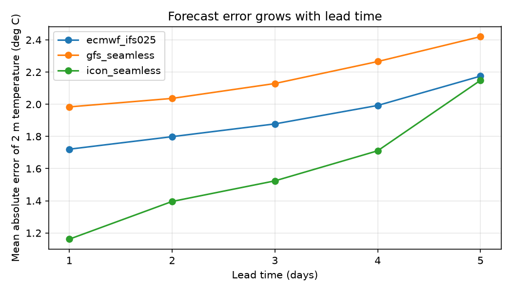
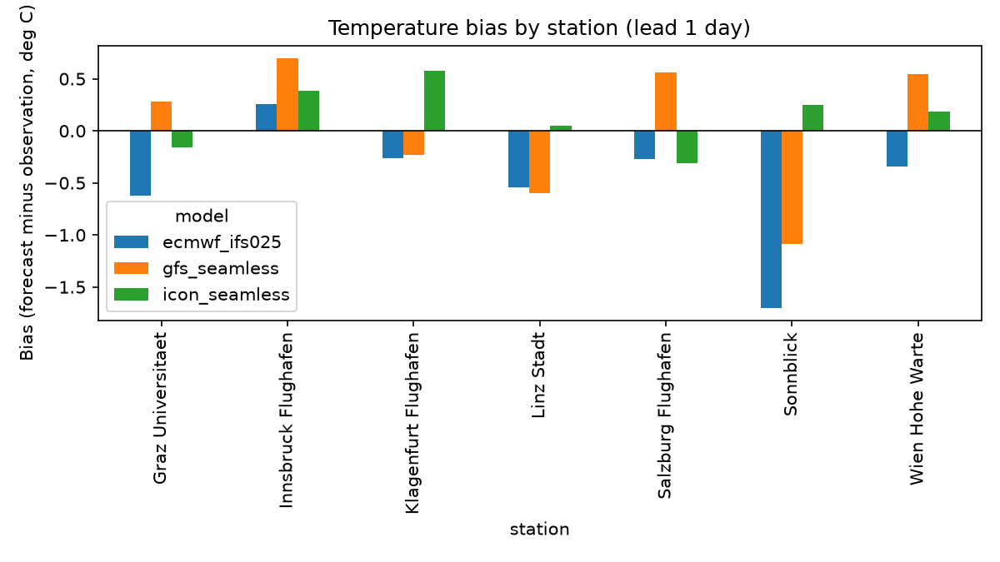
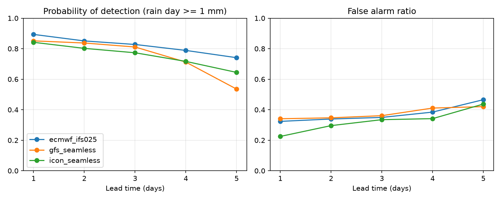

# Forecast Check Austria

How accurate are free weather forecasts for Austrian stations, and how fast does the error grow with lead time? This project compares three numerical weather model forecasts from Open-Meteo with GeoSphere Austria station measurements for 2025, using only open data and a fully reproducible Python pipeline.



## Key findings

Results are for 7 stations, one year (2025), forecast lead times of 1 to 5 days, averaged over stations.

1. **Error grows with lead time for every model.** The mean absolute error (MAE) of 2 m temperature rises from 1.16 to 1.98 °C at day 1 to 2.15 to 2.42 °C at day 5.
2. **ICON seamless has the lowest short-range error, but its advantage disappears by day 5.** At day 1 its MAE is 1.16 °C, against 1.72 °C for ECMWF IFS and 1.98 °C for GFS. At day 5 ICON and ECMWF are almost equal (2.15 and 2.17 °C), and GFS is highest (2.42 °C).
3. **Average temperature bias is small, except at the mountain station.** At day 1 the mean bias is -0.50 °C (ECMWF), +0.03 °C (GFS) and +0.14 °C (ICON). At Sonnblick (3109 m) ECMWF is 1.70 °C too cold and GFS 1.09 °C too cold, while ICON is only +0.25 °C off. Cause not investigated (see limitations).
4. **Rain-day detection falls and false alarms rise with lead time.** For days with at least 1 mm of rain (6 stations), the probability of detection drops from 0.84 to 0.89 at day 1 to 0.54 to 0.74 at day 5. The false alarm ratio rises from 0.22 to 0.34 at day 1 to 0.42 to 0.47 at day 5. ECMWF detects rain days best at every lead time, and GFS drops sharply at day 5.

These statements apply to the stations, period and model products tested here, not to the models in general.

### Temperature MAE (deg C), mean over 7 stations

| Model | Day 1 | Day 2 | Day 3 | Day 4 | Day 5 |
|---|---|---|---|---|---|
| ecmwf_ifs025 | 1.72 | 1.80 | 1.88 | 1.99 | 2.17 |
| gfs_seamless | 1.98 | 2.04 | 2.13 | 2.27 | 2.42 |
| icon_seamless | 1.16 | 1.40 | 1.52 | 1.71 | 2.15 |

### Rain days of 1 mm or more, mean over 6 stations

| Model | POD day 1 | POD day 5 | FAR day 1 | FAR day 5 |
|---|---|---|---|---|
| ecmwf_ifs025 | 0.89 | 0.74 | 0.32 | 0.47 |
| gfs_seamless | 0.85 | 0.54 | 0.34 | 0.42 |
| icon_seamless | 0.84 | 0.64 | 0.22 | 0.44 |

POD = probability of detection (share of observed rain days that were forecast). FAR = false alarm ratio (share of forecast rain days that stayed dry).




## Quick start

Requires Git and [Miniforge](https://github.com/conda-forge/miniforge) (conda).

```
git clone https://github.com/YOUR-USERNAME/forecast-check-austria.git
cd forecast-check-austria
conda env create -f environment.yml
conda activate forecast-check
python -m src.build_dataset
python -m src.make_figures
```

The first `build_dataset` run downloads about a year of data for 7 stations and 3 models and takes roughly 10 to 30 minutes. Every download is cached in `data/raw/`, so a repeated or interrupted run continues where it stopped. Figures are written to `outputs/figures/` and metric tables to `outputs/*.csv`. Run the tests with `pytest -q`.

## Data and licences

- **Observations:** GeoSphere Austria Data Hub, dataset `klima-v2-1h` (hourly station data). Data: GeoSphere Austria, CC BY 4.0.
- **Forecasts:** Open-Meteo Previous Runs API (archived forecasts at lead times of 1 to 5 days). Data: Open-Meteo.com, CC BY 4.0, free for non-commercial use.

Check the current licence terms of both providers before reuse. No data files are stored in this repository, they are downloaded by the scripts.

## Method

1. **Stations (7):** Wien Hohe Warte, Graz Universität, Linz Stadt, Salzburg Flughafen, Innsbruck Flughafen, Klagenfurt Flughafen and Sonnblick. Chosen to cover different terrain, and checked for data availability. Innsbruck Universität was replaced by Innsbruck Flughafen because it had no temperature values in the test month.
2. **Period and variables:** 1 January to 31 December 2025. Hourly 2 m air temperature and hourly precipitation.
3. **Models:** `ecmwf_ifs025`, `gfs_seamless` and `icon_seamless` as provided by Open-Meteo. The "seamless" products are blends and are not identical to the original model runs.
4. **Alignment:** all times in UTC. Forecasts and observations are joined on the hour. A shift test in July 2025 confirmed that the temperature error is lowest without any time shift (MAE 1.26 °C at 0 h, 1.36 and 1.48 °C at -1 and +1 h).
5. **Metrics:** temperature bias, MAE and RMSE per station, model and lead time. Precipitation is evaluated as daily UTC sums (only days with all 24 hours present), using a rain-day threshold of 1 mm and the scores POD and FAR.

Dataset size: 919,800 merged rows (7 stations, 3 models, 5 lead times, 8,760 hours). Missing values are dropped, never filled.

## Limitations

- **One year and seven stations.** Results may differ for other years, seasons and locations. Each station has equal weight in the averages.
- **Point versus grid cell.** Station measurements are compared with model grid values, which are averages over larger areas, especially in mountains and valleys. Some of the error is therefore representativeness, not model error.
- **Sonnblick.** The large cold bias of ECMWF and GFS at 3109 m was observed but its cause was not investigated. Open-Meteo applies an elevation adjustment to temperature, which may play a role. Sonnblick has no precipitation measurement and is evaluated for temperature only.
- **Precipitation time convention.** The dataset describes `rr` as an hourly sum but does not state whether the hour ends or starts at the time stamp. A correlation test at hourly resolution (summer 2025, 3 stations) was inconclusive. Evaluating daily sums limits the effect of a possible one-hour offset.
- **Blended model products.** `gfs_seamless` and `icon_seamless` may combine several model versions or resolutions, and a model change within the lead-time range cannot be ruled out. Lead-time definitions follow the Open-Meteo documentation (previous-day runs).
- **Quality flags** provided with the station data were not used.
- **Observation gaps.** Missing hours: temperature at Linz 120, Wien 32, Klagenfurt 24, Salzburg 6; precipitation at Graz 1 and Klagenfurt 2. Forecasts had no gaps.
- **Archive changes.** Archived forecasts may be revised by the provider, so results can change slightly if the data is downloaded again later.

## Project management

This project was planned and documented like a small delivery project.

- [Project plan with scope, milestones, risk register and data facts](docs/PROJECT_PLAN.md)
- [Changelog](CHANGELOG.md)
- Project board and issues: see the Projects tab of this repository.

Risks that actually occurred, and what was done: the API address changed from what the documentation example implied (fixed after checking the endpoint), several connection resets during download (retries with back-off recovered automatically), gaps in station data (dropped, not filled), and one unsuitable station (replaced after an availability check).

## Repository structure

```
config/        station list, period and models
src/           download, merge, metrics and figure scripts
tests/         unit tests for the metric functions
docs/          project plan
outputs/       result figures and metric tables
data/          cached downloads (not in Git)
```

## Licence

MIT, see `LICENSE`. Data are subject to the licences of the providers listed above.

## Acknowledgements

Station data: GeoSphere Austria. Forecast data: Open-Meteo.com.